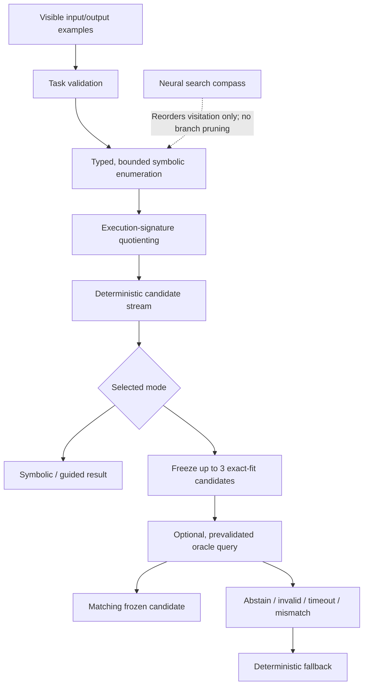

<p align="center">
  
</p>

<h1 align="center">Synth(ESQ-DSL)</h1>

<p align="center">
  <strong>Deterministic, bounded program synthesis for the typed integer/list fragment of DeepCoder.</strong>
</p>

<p align="center">
  Built by <a href="https://tenslab.dev">TENS LAB</a> · Python 3.10+ · Apache-2.0
</p>

<p align="center">
  <a href="https://doi.org/10.5281/zenodo.24373016"></a>
  <a href="https://github.com/Kshitijpalsinghtomar/synth/releases/tag/v1.0.0">Release 1.0.0</a>
  ·
  <a href="https://doi.org/10.5281/zenodo.24373017">Versioned Zenodo record</a>
  ·
  <a href="https://huggingface.co/Kshitijpalsinghtomar/synth-compass">Model checkpoint</a>
</p>

---

Synth searches for bounded, typed programs that satisfy input/output examples. It combines symbolic enumeration with three deliberately separated mechanisms: execution-signature quotienting, optional neural search ordering, and optional one-turn oracle disambiguation.

It is a **symbolic synthesizer with learned search guidance**—not an LLM that directly generates programs, and not a general-purpose synthesizer.

## How it works

1. **Typed bounded enumeration.** Programs are enumerated in the integer/list DSL under explicit operator, signature and time limits, with strict intermediate-value semantics.
2. **Execution-signature quotienting.** For the visible examples, each candidate is represented by its output signature and type. Candidates with the same signature share one deterministic representative, selected by operator cost and then lexical expression.
3. **Neural search compass (optional).** A 137,897-parameter CPU model predicts operator, lambda and program-length priors. These priors reorder candidate visitation; they do not prune grammar branches, remove valid candidates or predict hidden outputs.
4. **One-turn oracle (interactive mode only).** Synth freezes up to three shortest distinct exact-fit candidates, validates a disagreement query against that portfolio, and asks an oracle at most once. Only a response matching a frozen candidate can change the selection. Abstention, invalid input, timeout or mismatch preserves the deterministic fallback.

> **Important distinction:** equal execution signatures mean indistinguishable on the *visible examples*. They do not prove that two programs are semantically equivalent for every possible input.

### Architecture



### Operating modes

| Mode | What it does | Dependencies |
|---|---|---|
| `symbolic` | Bounded typed enumeration without neural guidance or an oracle | Core package only |
| `guided` | Same branch-preserving search, with learned priors ordering visitation | Optional NumPy and PyTorch |
| `interactive` | Guided search plus a frozen candidate portfolio and at most one oracle turn | Optional NumPy and PyTorch; human terminal adapter by default |

The names V1, V3 and V5 are historical research milestones corresponding to the three modes; they are not software version numbers. V6 is an evaluation protocol/cohort, not another mode or model architecture.

## Quick start

Python 3.10 or later is required.

Clone and install the core package:

```bash
git clone https://github.com/Kshitijpalsinghtomar/synth.git
cd synth
python -m pip install -e .
```

The symbolic mode has no mandatory third-party runtime dependency. For neural-guided and interactive modes:

```bash
python -m pip install -e ".[neural]"
```

Create `sample_task.json`:

```json
{
  "task_id": "reverse-list-example",
  "inputs": {
    "x0": [[1, 2, 3], [2, 3, 4], [3, 4, 5]]
  },
  "outputs": [[3, 2, 1], [4, 3, 2], [5, 4, 3]],
  "input_specs": {
    "x0": {
      "range": [0, 10],
      "length": [1, 5]
    }
  }
}
```

Run any of the three modes:

```bash
# No model required
synth sample_task.json --mode symbolic

# Neural priors reorder search visitation
synth sample_task.json --mode guided \
  --checkpoint checkpoints/esq_v3_converged.pt

# At most one oracle request
synth sample_task.json --mode interactive \
  --checkpoint checkpoints/esq_v3_converged.pt
```

Interactive mode uses a human terminal adapter by default. An optional local subprocess adapter can be provided with `--oracle-command`; it receives one JSON request on standard input and returns one JSON response on standard output. It is launched without a shell. Connect only an oracle authorized to answer the task.

The Python API is available through `run_task` in `esq_dsl.cli`. See the [architecture guide](docs/ARCHITECTURE.md) and [documentation index](docs/README.md) for API details, protocols and implementation notes.

## Evaluation

The repository contains **two separate evaluation regimes**. Their datasets, checkpoints, denominators and evidence boundaries differ. They must not be combined into one leaderboard.

### 1. External DeepCoder task splits

These evaluations use public DeepCoder task splits from the ExeDec repository, with Synth's bounded synthesizer and fresh-input behavioural evaluation. They are **not** reproductions of ExeDec's trained Transformer baselines or its complete official evaluator.

| Split | Method / checkpoint | Complete fresh-behaviour matches | Fresh-case accuracy |
|---|---|---:|---:|
| `SWITCH_CONCEPT_ORDER` | ESQ-03 symbolic baseline | **144/180 (80.00%)** | **7,947/8,937 (88.92%)** |
| `LENGTH_GENERALIZATION` | Original V3 prior-guide checkpoint | **118/180 (65.56%)** | **78.69%** |
| `LENGTH_GENERALIZATION` | V1 symbolic baseline | **108/180 (60.00%)** | **75.23%** |

The V3 length-generalization result is a historical comparison against the V1 symbolic baseline on the same confirmation split. **It used the original V3 checkpoint (SHA-256 beginning `1e5e086f`), not the checkpoint packaged in release 1.0.0.** Do not attribute the 118/180 result to the packaged release model.

Reports: [ESQ-03 baseline](docs/experiments/v1-baseline.md) · [V3 confirmation](docs/experiments/v3-positive-result.md) · [model inventory and checkpoint distinction](docs/MODEL_INVENTORY.md).

### 2. V6 strict depth-4 structural-family-held-out cohort

V6 compares four existing configurations on one frozen synthetic cohort. The 200-task cohort has 196 eligible tasks for complete fresh-behaviour matching and 8,869 valid fresh cases for pooled case accuracy. Accepted structural families had zero overlap with the pinned prior-family exclusion archive.

| Configuration | Complete fresh-behaviour matches (n=196) | Fresh-case accuracy (n=8,869) |
|---|---:|---:|
| V1 symbolic | 60/196 (30.61%) | 70.03% |
| V3 guided | 62/196 (31.63%) | 70.77% |
| V5 ablation | 70/196 (35.71%) | 74.36% |
| V5 full | 71/196 (36.22%) | 74.34% |

**How to interpret this:** V5 full records one more complete fresh-behaviour match than V5 ablation (+0.51 percentage points), while its pooled fresh-case accuracy is 0.02 points lower. These are descriptive results from one fixed cohort; no repeated-seed or inferential analysis was performed. The ablation also uses the one-turn portfolio/oracle stage, so this comparison does not isolate the oracle's causal effect.

V6 uses a **local file-backed synthetic reference oracle**. It is not an official ExeDec benchmark, a human-oracle study, or evidence of general performance on the official ExeDec distribution.

Reports: [V6 results and provenance](docs/experiments/v6-four-way-200-results.md) · [locked V6 protocol](docs/experiments/v6-strict-depth4-preflight-protocol.md) · [historical V5 recovery and validity audit](docs/experiments/v5-four-way-200-recovery-audit.md).

## Model and reproducibility

The release includes the `ESQSetEncoder` checkpoint:

- **Parameters:** 137,897 total; 78,664 are used by the trained operator/lambda/length prior heads. The remaining 59,233 belong to a legacy candidate-ranker branch not optimized by this training objective.
- **Inference:** CPU; no GPU required.
- **Checkpoint:** [`esq_v3_converged.pt`](https://github.com/Kshitijpalsinghtomar/synth/releases/download/v1.0.0/esq_v3_converged.pt)
- **SHA-256:** `a0f03d5066d86022d932699c1a6dfe68957d56131a38e7816e2085bda2000d41`
- **Model card and metadata:** [`model_card.json`](checkpoints/model_card.json) · [Hugging Face model repository](https://huggingface.co/Kshitijpalsinghtomar/synth-compass)

The loader verifies the bundled checkpoint against its SHA-256 sidecar and model card before loading. A matching digest verifies byte identity; it is not a malware scan. See [SECURITY.md](SECURITY.md) for checkpoint-loading guidance and PyTorch compatibility.

The training procedure and synthetic-data generation code are in [`training/`](training/README.md). Benchmark protocols and scoring implementation are in [`benchmarks/`](benchmarks/README.md). Generated corpora, supervision arrays, reference programs, hidden target maps and private oracle traces are not included in the public repository.

## Scope and limitations

- Synth targets the **typed integer/list fragment** of the DeepCoder DSL; it is not a general-purpose program synthesizer.
- Search is bounded by configured operator, signature and time limits. A run stopped by a cap is truncated; it does not prove that the search space was exhausted.
- Execution-signature equality is defined over visible examples, not all possible inputs.
- Interactive mode allows zero or one oracle response. It is not iterative CEGIS and does not resynthesize after an answer.
- The V6 cohort is synthetic and uses a local reference oracle. No human-oracle evaluation or full official ExeDec evaluation is claimed.
- The repository does not claim state-of-the-art performance or a head-to-head win over DeepCoder, ExeDec, PROSE, BUSTLE or CrossBeam.

For prior-art context and the full experimental history, see the [documentation index](docs/README.md).

## Citation

Synth 1.0.0 is archived as a versioned software release on Zenodo. **It is a software release, not a peer-reviewed research paper.**

- Version-specific DOI: [10.5281/zenodo.24373017](https://doi.org/10.5281/zenodo.24373017)
- Concept DOI (all versions): [10.5281/zenodo.24373016](https://doi.org/10.5281/zenodo.24373016)
- Machine-readable citation: [`CITATION.cff`](CITATION.cff)

```bibtex
@software{synth_esq_dsl_2026,
  author    = {Pal, Kshitij},
  title     = {Synth (ESQ-DSL): Deterministic Program Synthesis via
               Execution-Signature Quotienting},
  version   = {1.0.0},
  year      = {2026},
  publisher = {Zenodo},
  doi       = {10.5281/zenodo.24373017},
  url       = {https://github.com/Kshitijpalsinghtomar/synth}
}
```

## License and acknowledgements

First-party Synth source code and the packaged model checkpoint are licensed under **Apache-2.0**. Third-party dependencies and upstream benchmark materials retain their own licenses; excluded research data and hidden target artifacts are not covered by this grant. See [LICENSE](LICENSE), [THIRD_PARTY_NOTICES.md](THIRD_PARTY_NOTICES.md) and the [commercial and license audit](docs/COMMERCIAL_AND_LICENSE_AUDIT.md).

The external DeepCoder task split provenance is documented in the repository. Synth does not redistribute the official ExeDec dataset or relicense upstream materials.

---

<p align="center">
  <strong>TENS LAB</strong> · <a href="https://tenslab.dev">tenslab.dev</a>
</p>
